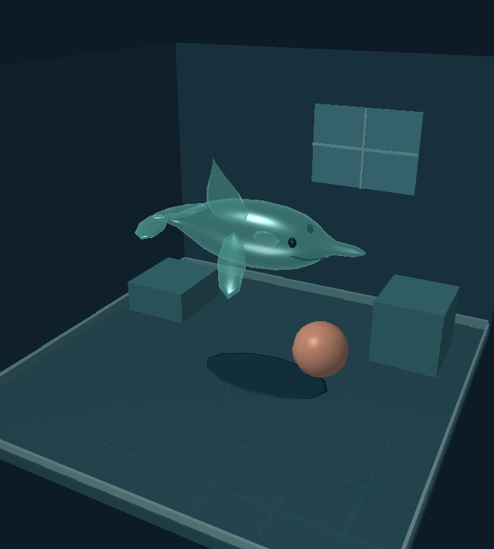

# Jelly Dolphin — 3D Jelly Room

A native, offline Android toy with a **volumetric 3D dolphin**, a small room, and
particle-based jiggle physics. No account, Internet access, or game-engine download
is needed to play.



## Install version 2.1

Download [`dist/jelly-dolphin-2.1.apk`](dist/jelly-dolphin-2.1.apk) on an Android
6.0+ phone supporting OpenGL ES 2.0. Open it and allow installation from your
browser/file manager when prompted. This is a debug-signed testing build, not a
Play Store release. Earlier testing APKs are retained in `dist` for comparison.

## New in 2.1

The dolphin now behaves like a shape-retaining squishy toy. Grabs distribute force
through its body, a rotating shape envelope prevents excessive stretching, and
bounded compression/bending springs produce a visible wobble after taps, throws
and impacts. Compression expands the other axes to retain volume. Wobble decays
naturally, and resting contacts do not keep adding bounce energy.

The skin is now glossy and translucent, with bright softbox-style highlights and
stronger edge reflections. **Jelly clarity** adjusts it from cloudy to clearer;
this setting is saved alongside colour, squishiness and gravity.

## Play

- **Drag the dolphin** to grab a point on its mesh, lift, gently squish, and throw it.
- **Tap the dolphin** to send a local impulse through its body, fins, and tail.
- **Pinch while holding an object** to move it toward or away from the camera.
- Use **Depth** to move the dolphin along the room's front/back axis.
- **Drag empty space** to orbit the camera; **pinch empty space** to zoom.
- **Tap or drag the peach ball**. It bounces and interacts with the dolphin.
- Floor, walls, ceiling boundary, and raised blocks constrain the particles.
- Choose from six colours, change squishiness and jelly clarity, toggle gravity, or use **Shake**.
- **Reset** restores the dolphin, ball, and camera. **How to play** explains gestures.
- Colour, squishiness, clarity, and gravity are remembered after reopening the app.

## Build

JDK 21, Android SDK 35, build-tools 35.0.0, AGP 8.9.2; checksum-pinned Gradle 8.13.
No third-party application dependencies. The app uses the Android OpenGL ES API.

```sh
# Cloud environment toolchain, already prepared:
source /workspace/toolchains/activate.sh
# Refresh installation if needed:
bash scripts/setup-cloud.sh
# From this checkout:
./gradlew --no-daemon --max-workers=2 assembleDebug lintDebug
./scripts/test-physics.sh
./scripts/test-scene.sh
```

On another machine, set `JAVA_HOME` and `ANDROID_HOME` to your JDK and Android SDK.
APK output is `app/build/outputs/apk/debug/app-debug.apk`.
The optional host rendering test needs Java, Python with NumPy/Pillow, and Mesa
EGL supporting a surfaceless GLES 2 context. It writes `build/scene/room.png`.

With a working emulator or attached test phone:

```sh
adb install -r app/build/outputs/apk/debug/app-debug.apk
adb shell am start -n com.jellydolphin.app/.MainActivity
./scripts/smoke-device.sh
python3 tests/device-interactions.py
```

## Implementation and limits

`SoftBody3D` simulates 436 surface particles with XPBD distance constraints,
interior thickness braces, and body-to-fin connections. A best-fit rotating pose
limits local strain without fixing the toy's orientation. Bounded, damped
compression and bending modes drive the mesh's rest constraints; the compression
mode compensates on the other axes to preserve volume. Distributed grabbing
moves the toy through a broad patch. Contact momentum is corrected to prevent
constraint corrections from manufacturing bulk bounce energy. Fixed 120 Hz
substeps and velocity limits keep the simulation bounded. This remains a
position-based toy simulation, without fluid flow or self-collision.

`RoomRenderer` submits a dynamically deformed triangle mesh to OpenGL ES 2 with
smooth normals, directional/specular lighting, perspective projection and a
projected floor shadow. Opaque room/props render first; the jelly then uses
premultiplied-alpha blending with separate back/front surface passes and depth
writes disabled. Fresnel-style edges and analytic light reflections give the
material its gloss. Transparency is an approximation: there is no refracted
background image, and intersecting translucent parts can show ordering artifacts. Geometry is generated locally. The ball is a separate
sphere with gravity, grabbing, boundary/box contacts, and approximate soft-body
contact impulses. Camera rays pick mesh particles or the ball. Touch commands are
queued on the GL thread; animation and sensors pause with the activity.

The first 3D version is English and designed for portrait phones. The floor
shadow is a visual approximation. Very fast movement can tunnel through thin
obstacles because collision detection is discrete. Physical shaking and haptics
need suitable hardware. See [VALIDATION.md](VALIDATION.md) for checks actually run.

Use a separate private release signing key for store distribution. Never commit
signing credentials.
